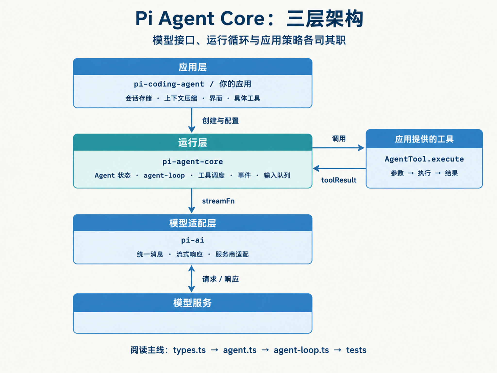
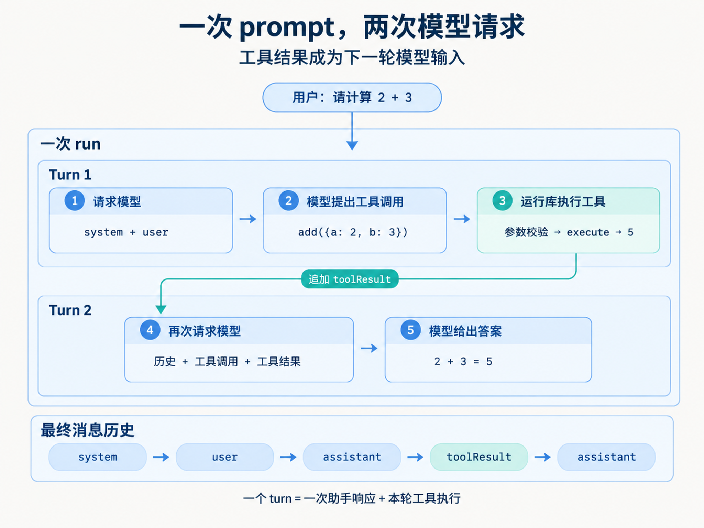
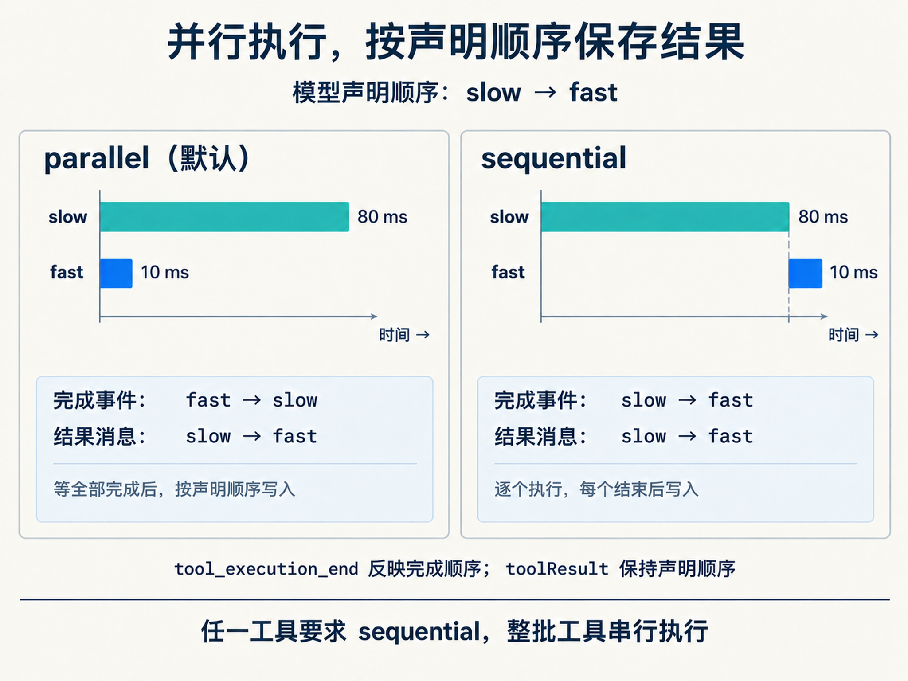
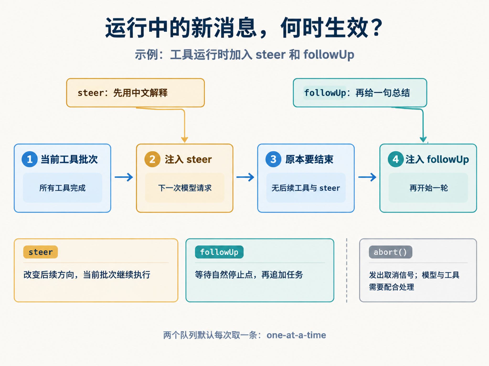
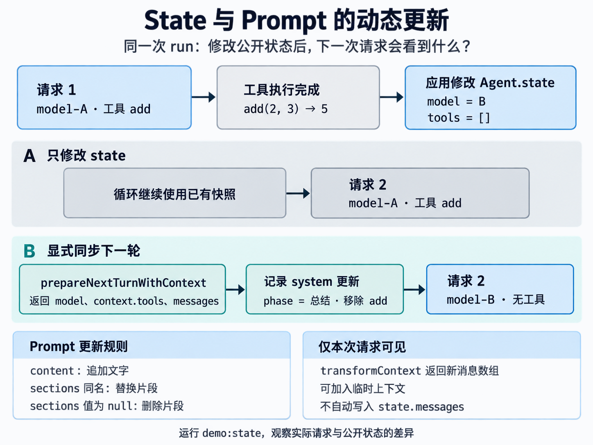

# Pi Agent Core 说明图集

五张说明图已嵌入文档：前四张在 [中文源码解析](pi-agent-core-guide.md) 的第 1、4、8、9 节，第五张在 [State 与 Prompt 专题](state-and-prompt.md)。按“架构 → 工具循环 → 执行顺序 → 新输入时机 → 状态与 Prompt 更新”的顺序阅读。

图中机制对应源码提交 `7bd01fb92485c06f92ecfff7ccf3197148bc16af`。图示聚焦正常路径，异常与钩子边界以正文为准。

## 1. 三层架构



阅读重点：应用提供策略和具体工具；Core 管理循环与状态；`streamFn` 连接模型接口。`pi-ai` 负责模型适配。

[PNG 原图](../output/imagegen/01-architecture.png) · [完整提示词](../output/imagegen/prompts/01-architecture.txt)

## 2. 一次输入，两次模型请求



阅读重点：模型提出调用，运行库执行工具，工具结果进入历史，再由模型生成答案。一个 run 可以包含多个 turn。

[PNG 原图](../output/imagegen/02-tool-loop.png) · [完整提示词](../output/imagegen/prompts/02-tool-loop.txt)

## 3. 完成顺序与消息顺序



阅读重点：默认并行时，`tool_execution_end` 可以先收到 fast，但 `toolResult` 仍按 slow、fast 的声明顺序加入消息历史。图中 80ms、10ms 是教学等待值，时间条示意先后与重叠关系，省略了钩子与事件处理耗时。

[PNG 原图](../output/imagegen/03-parallel-order-v3.png) · [初始提示词](../output/imagegen/prompts/03-parallel-order.txt) · [顺序修正提示词](../output/imagegen/prompts/03-parallel-order-correction.txt) · [轴线简化提示词](../output/imagegen/prompts/03-parallel-order-axis-cleanup.txt)

## 4. steer、followUp 与 abort



阅读重点：steer 改变后续方向，当前批次工具继续执行；followUp 在原本要结束时追加任务。abort 发出独立的协作式取消信号。

这张图对应一批工具和两条排队消息的具体例子。若 steering 处理后又产生工具调用，就会继续工具链；不能把图中四步理解成所有运行必经的固定四步。

[PNG 原图](../output/imagegen/04-input-queues.png) · [完整提示词](../output/imagegen/prompts/04-input-queues.txt)

## 5. State 与 Prompt 的动态更新



阅读重点：同一次 run 中，公开 state 的赋值不会自动替换循环快照。下一轮钩子返回 model、context.tools 与 system 补丁，才把应用选择同步给循环。`content` 累加，具名 `sections` 支持替换和删除；返回新数组的 `transformContext` 可提供不写入历史的临时上下文。

图中 A/B 是两个独立对照场景，运行 `npm run demo:state` 可以复现。钩子必须预先安装，下一轮必须已被调度；完整边界见专题正文。

[文档用 PNG](../output/imagegen/05-state-and-prompt-opaque.png) · [模型返回原图](../output/imagegen/05-state-and-prompt.png) · [完整提示词](../output/imagegen/prompts/05-state-and-prompt.txt)

第五张服务返回 1448×1086 的透明 PNG；为确保浅色和深色文档背景下都能阅读，使用 Pillow 合成到 `#fafbfd` 底色，未修改文字、箭头或尺寸。前四张最终图为 2048×1536。

## 生成记录

| 项目 | 内容 |
| --- | --- |
| 用户指定模型 | GPT Image 2.5 |
| 配置别名 | `gpt-image-2.5` → `gpt-image-2.5-flare` |
| 执行方式 | imagegen 技能的配置服务商 CLI，`generate-batch` / `generate` 生成，`edit` 修正第三张图 |
| 服务商 API 地址 | `https://www.lingqiaotech.com/v1` |
| 请求设置 | 每图 1 张，请求 `2048x1536`，`quality=high`，PNG；实际返回尺寸见图片清单 |
| 生成日期 | 2026-10-13，Asia/Shanghai |
| 保存目录 | `output/imagegen/`（相对于学习仓库） |
| 提示词 | 同目录下 `prompts/`，保留五份生成提示词和第三张图的两份编辑提示词 |

生成提示词明确了图中逐字文字、箭头方向和职责约束；全部使用 `--no-augment` 提交，不再添加 CLI 自动提示。图片服务收到的是这些提示词，以及第三张图编辑时需要的已有图片。

需要重新生成单张图时，可使用同一模型并写入新的版本文件名。下面的命令要求本机已安装 Codex imagegen 技能、对应 Python 环境并配置图片服务商；这些本机组件不包含在学习仓库中。

```bash
# 在学习仓库根目录执行
"${CODEX_HOME:-$HOME/.codex}/imagegen/venv/bin/python" \
  "${CODEX_HOME:-$HOME/.codex}/skills/.system/imagegen/scripts/image_gen.py" generate \
  --model gpt-image-2.5-flare \
  --prompt-file output/imagegen/prompts/01-architecture.txt \
  --size 2048x1536 --quality high --output-format png --no-augment \
  --out output/imagegen/01-architecture-v2.png
```

这是会实际调用已配置图片服务的生成命令。服务凭据由本地 imagegen 配置读取，不包含在文档或提示词中。
