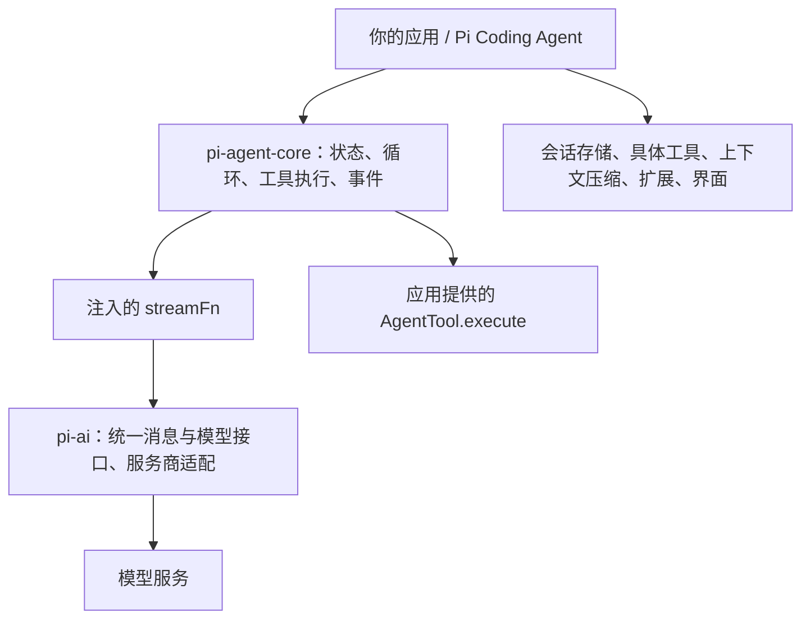

# Pi Agent Core 源码解析

基于 2026-10-13 下载的 `earendil-works/pi`，提交 `7bd01fb92485c06f92ecfff7ccf3197148bc16af`。文中的行为以该提交的实现和测试为准。

**Pi Agent Core 是一个有状态的 Agent 运行库：它把模型响应、工具执行、消息历史和事件通知组织成可持续运行的循环。** 模型负责提出工具调用和生成回答；这个库负责执行调用、回填结果，并决定下一次请求何时开始。

例如，用户说“算一下 2 + 3”：模型返回 `add({a: 2, b: 3})`，运行库找到 `add` 函数并执行，把结果 `5` 追加为 `toolResult`，再请求一次模型，得到自然语言答案。这一轮用户输入可以产生多次模型请求。

重点关注 Agent 状态与提示词时，接着读 [State 管理、Prompt 编排与动态更新](state-and-prompt.md)。其中包含运行快照、具名 Prompt 补丁、请求投影、会话保存的源码分析，以及 `npm run demo:state` 对照实验。

## 1. 先分清三个层次


图 1：先看职责边界，再沿箭头看调用关系。`AgentTool.execute` 由应用提供，运行循环负责调度。原图和生成提示词见 [说明图集](illustrations.md)，图集另含 State 与 Prompt 动态更新图。

<details>
<summary>展开可编辑的 Mermaid 架构图</summary>



</details>

| 层次 | 主要职责 | 建议先读的入口 |
| --- | --- | --- |
| `pi-ai` | 模型/服务商接口、统一消息类型、流式事件、参数校验等基础能力 | [README](https://github.com/earendil-works/pi/blob/7bd01fb92485c06f92ecfff7ccf3197148bc16af/packages/ai/README.md)、[消息类型](https://github.com/earendil-works/pi/blob/7bd01fb92485c06f92ecfff7ccf3197148bc16af/packages/ai/src/types.ts#L541) |
| `pi-agent-core` | 维护运行状态，执行工具循环，排队接收输入，发出生命周期事件 | [核心包 README](https://github.com/earendil-works/pi/blob/7bd01fb92485c06f92ecfff7ccf3197148bc16af/packages/agent/README.md) |
| `pi-coding-agent` | 编码场景的完整应用：工具、会话、压缩、扩展和交互入口 | [SDK 组装位置](https://github.com/earendil-works/pi/blob/7bd01fb92485c06f92ecfff7ccf3197148bc16af/packages/coding-agent/src/core/sdk.ts#L411) |

`pi-agent-core` 没有自带 `read/bash/edit/write` 的具体实现。它接受应用传入的工具集合。当前核心包也不负责会话落盘、自动压缩策略或多 Agent 编排；这些能力要看上层应用，持久化运行时还可参考 `pi-durable`。1.0.0 的拆分记录见 [CHANGELOG](https://github.com/earendil-works/pi/blob/7bd01fb92485c06f92ecfff7ccf3197148bc16af/packages/agent/CHANGELOG.md#L25)。

理解这一层后，你可以用它做客服、数据分析或工作流 Agent；“编码”来自工具和应用策略。

## 2. 源码地图与阅读顺序

核心源码共 6 个 TypeScript 文件，合计约 2,519 行，包含注释和空行。最关键的两个实现文件合计约 1,562 行。

| 顺序 | 文件 | 你要回答的问题 |
| --- | --- | --- |
| 1 | [types.ts](https://github.com/earendil-works/pi/blob/7bd01fb92485c06f92ecfff7ccf3197148bc16af/packages/agent/src/types.ts) | 消息、工具、状态、事件、钩子分别长什么样？ |
| 2 | [agent.ts](https://github.com/earendil-works/pi/blob/7bd01fb92485c06f92ecfff7ccf3197148bc16af/packages/agent/src/agent.ts) | 一次 `prompt()` 如何启动？谁保存历史？队列和取消归谁管？ |
| 3 | [agent-loop.ts](https://github.com/earendil-works/pi/blob/7bd01fb92485c06f92ecfff7ccf3197148bc16af/packages/agent/src/agent-loop.ts) | 何时请求模型、何时执行工具、何时继续或停止？ |
| 4 | [agent-loop.test.ts](https://github.com/earendil-works/pi/blob/7bd01fb92485c06f92ecfff7ccf3197148bc16af/packages/agent/test/agent-loop.test.ts) | 并行、队列、钩子等边界行为有什么可执行证据？ |
| 5 | [stream-fn.ts](https://github.com/earendil-works/pi/blob/7bd01fb92485c06f92ecfff7ccf3197148bc16af/packages/agent/src/stream-fn.ts) | 模型请求函数如何注入？旧调用者如何使用全局默认值？ |
| 6 | [proxy.ts](https://github.com/earendil-works/pi/blob/7bd01fb92485c06f92ecfff7ccf3197148bc16af/packages/agent/src/proxy.ts) | 浏览器通过后端代理访问模型时，如何重建响应流？ |

[index.ts](https://github.com/earendil-works/pi/blob/7bd01fb92485c06f92ecfff7ccf3197148bc16af/packages/agent/src/index.ts) 只汇总导出。第一遍可以暂时跳过代理实现，把 `StreamFn` 看成可替换的模型接口。

## 3. 五个核心数据结构

| 类型 | 含义 | 具体例子 |
| --- | --- | --- |
| `AgentMessage` | 标准消息与应用自定义消息的联合类型 | 用户问题、助手工具调用、工具结果、UI 通知 |
| `AgentContext` | 一次底层运行使用的消息历史和可执行工具 | `{ messages, tools }` |
| `AgentState` | Agent 对外暴露的模型、工具、历史和运行状态 | `messages`、`isStreaming`、`pendingToolCalls` |
| `AgentTool` | 模型可见的工具声明，加上真实执行函数 | `name + description + parameters + execute` |
| `AgentEvent` | 运行过程中的结构化通知 | `message_update`、`tool_execution_end` |

### 消息是模型交互的主线

当前 `pi-ai` 的标准 `Message` 包含四种角色：`system`、`user`、`assistant`、`toolResult`。`AgentMessage` 在此基础上允许通过 TypeScript 的声明合并扩展角色。

以下是结构示意，省略模型元数据、时间和 usage，不能直接当作完整类型使用：

```text
system:    使用 add 工具计算
user:      2 + 3 等于多少？
assistant: toolCall(id=add-1, name=add, arguments={a:2,b:3})
toolResult: toolCallId=add-1, content="5", isError=false
assistant: 2 + 3 = 5
```

工具调用是 assistant 消息里的一个内容块。工具结果是单独的消息，通过 `toolCallId` 对应到调用。一个 assistant 消息可以同时包含文字、思考内容和多个工具调用。

### System 消息也在历史中

[createMutableAgentState](https://github.com/earendil-works/pi/blob/7bd01fb92485c06f92ecfff7ccf3197148bc16af/packages/agent/src/agent.ts#L82) 把初始化的 `systemPrompt` 和工具声明放入开头的 system 消息，前提是传入的历史没有以 system 开头。

运行时的 `state.systemPrompt` 是从历史重放得到的只读值。更新提示词通过追加 system 消息表达；`content` 累加，具名 `sections` 支持替换或移除片段。同一 run 内应通过下一轮钩子的 `messages` 或排队入口注入；直接给公开历史数组追加消息不会自动同步到循环快照。

`state.tools` 保存真正可执行的工具函数。循环中的 [declareToolChanges](https://github.com/earendil-works/pi/blob/7bd01fb92485c06f92ecfff7ccf3197148bc16af/packages/agent/src/agent-loop.ts#L333) 对比可执行工具和历史里声明的工具，把增删信息写为 system 消息。模型看到声明，运行库持有函数。

因此，编写 `convertToLlm` 时应保留 system 消息。核心 README 的某些简写段落仍只列三种角色；完整类型、默认转换器和测试已包含 system。

## 4. 从 prompt() 跟踪到模型回答


图 2：这是一次成功工具调用的常见路径。第一轮包含工具执行，第二轮根据工具结果生成答案；错误、终止和队列分支见后文。

从 [Agent.prompt](https://github.com/earendil-works/pi/blob/7bd01fb92485c06f92ecfff7ccf3197148bc16af/packages/agent/src/agent.ts#L371) 开始，沿着下面这条调用链阅读：

```text
Agent.prompt()
  → normalizePromptInput()       将字符串/图片转换成 user 消息
  → runPromptMessages()
  → runWithLifecycle()          创建 AbortController，标记正在运行
  → runAgentLoop()              初始化上下文与事件
  → runLoop()                   决定每一轮如何推进
      → prepareRequest()
      → streamAssistantResponse()
      → executeToolCalls()      本轮有工具调用时
      → finishTurn()
      → 队列检查 / 下一轮 / 结束
  → finishRun()                 清理临时状态，变为 idle
```

`prompt()` 返回 `Promise<void>`。最终答案从事件或 `agent.state.messages` 读取，而不是从返回值读取。

<details>
<summary>展开包含事件与订阅者的详细时序图</summary>

```mermaid
sequenceDiagram
    participant App as 应用
    participant Agent as Agent
    participant Loop as agent-loop
    participant Model as streamFn / 模型
    participant Tool as AgentTool.execute
    App->>Agent: await prompt("2 + 3")
    Agent->>Loop: runAgentLoop(messages, context, config)
    Loop->>Model: system + user
    Model-->>Loop: assistant(toolCall: add)
    Loop-->>Agent: message_end
    Note over Agent: 更新历史并等待订阅者
    Loop->>Tool: 校验参数后 execute(2, 3)
    Tool-->>Loop: content="5", details={sum:5}
    Loop-->>Agent: tool_execution_end + toolResult 消息
    Loop->>Model: 历史 + 工具调用 + 工具结果
    Model-->>Loop: assistant("2 + 3 = 5")
    Loop-->>Agent: turn_end + agent_end
    Note over Agent: 等待结束事件订阅者完成，再清理运行状态
    Agent-->>App: prompt 完成
```

</details>

一个 **turn** 是一次助手响应及其工具执行；一个 **run** 是一次 `prompt()` 或 `continue()` 启动的完整运行，可包含多个 turn。[本地示例 01](../study/01-tool-loop.ts) 正好包含两个 turn。

## 5. runLoop 为什么有内外两层循环

[runLoop](https://github.com/earendil-works/pi/blob/7bd01fb92485c06f92ecfff7ccf3197148bc16af/packages/agent/src/agent-loop.ts#L163) 的内层处理工具链和 steering 消息；外层负责“本来要结束时，是否还有 follow-up 或显式继续请求”。

正常情况下的调度次序可以概括为：

1. 处理已选中的输入；后续轮次可先执行 `prepareNextTurn`。
2. 执行 `prepareRequest`，请求模型。
3. 将 assistant 消息完整写入上下文；如有工具调用，完成这一批工具并加入结果。
4. 执行 `finishTurn`，发出 `turn_end`。
5. `finishTurn` 返回 `end` 时立即结束本次 run。
6. 否则检查 steering；普通工具结果或 steering 会触发下一轮。
7. 没有这些工作时检查 follow-up。
8. 仍没有下一轮时，才兑现 `finishTurn: continue` 要求的额外请求；都没有则结束。

模型返回 `error` 或 `aborted` 时是硬退出：仍调用 `finishTurn` 和结束事件，但忽略它的继续决定。

`finishTurn` 返回 `continue` 的意思是“至少再请求一次”。如果工具结果或队列已经导致下一次请求，就不会额外再增加一次。无条件每次返回 `continue` 会形成无限循环。

循环没有内置一个通用的固定轮数上限。应用需要控制轮次或预算时，可以在 `finishTurn` 中计数。这个钩子发生在本轮工具执行之后；需要阻止某个工具，应使用执行前的钩子。

## 6. 上下文如何送入模型

[streamAssistantResponse](https://github.com/earendil-works/pi/blob/7bd01fb92485c06f92ecfff7ccf3197148bc16af/packages/agent/src/agent-loop.ts#L381) 在模型调用边界完成转换：

```text
AgentContext.messages
  → transformContext(messages, signal)     可选；在 AgentMessage 层加工上下文
  → convertToLlm(messages)                 转成标准 Message[]
  → normalizeContext({ messages })         得到 TranscriptContext
  → getApiKey(provider)                    可选；每次请求动态取凭据
  → streamFn(model, context, options)      获取 AssistantMessageEventStream
```

| 钩子 | 适用问题 | 关键边界 |
| --- | --- | --- |
| `transformContext` | 检索资料、裁剪或转换请求上下文 | 返回新数组不会自动替换 `Agent.state.messages`；避免无意修改传入数组 |
| `convertToLlm` | UI 自定义消息怎样映射成模型可理解的消息 | 返回标准角色消息；不能把自定义 role 原样交给服务商 |
| `prepareRequest` | 每次请求前从会话存储安装最新上下文、模型等运行值 | 包含首次请求；执行时不会再次抽取 steering 队列 |
| `prepareNextTurn` / `prepareNextTurnWithContext` | 确定会继续时，压缩上下文、刷新工具、追加消息 | 首次请求前不调用，最终轮次后也不调用 |

核心库提供接口；实际自动压缩策略要看 [AgentSession 的下一轮准备逻辑](https://github.com/earendil-works/pi/blob/7bd01fb92485c06f92ecfff7ccf3197148bc16af/packages/coding-agent/src/core/agent-session.ts#L898)。

裁剪历史时，要维护 system 提示、工具声明，以及工具调用与结果的对应关系。简单截取“最后 10 条”可能留下没有对应调用的 toolResult。

当前 `StreamFn` 接收的 `TranscriptContext` 只有消息这一条上下文主线，prompt 和工具声明在 system 消息中。不要照搬旧示例，把它们作为独立的 `context.systemPrompt` 和 `context.tools` 传入。

`StreamFn` 可以连接真实模型，也可以返回本地脚本生成的事件流。这就是本工作区能在无需 API Key 的情况下演示真实循环的原因。

## 7. 一个工具调用经过哪些步骤

从 [executeToolCalls](https://github.com/earendil-works/pi/blob/7bd01fb92485c06f92ecfff7ccf3197148bc16af/packages/agent/src/agent-loop.ts#L508) 进入，执行链为：

```text
tool_execution_start
  → 按工具名查找 AgentTool
  → prepareArguments（可选参数预处理）
  → validateToolArguments（schema 校验，可能进行类型转换）
  → beforeToolCall（可拦截）
  → execute(toolCallId, args, signal, onUpdate)
  → 等待进度事件处理完成
  → afterToolCall（可替换结果字段）
  → tool_execution_end
  → message_start / message_end（toolResult）
```

完整可运行的工具定义见 [示例 01 的 add](../study/01-tool-loop.ts#L6)。参数 schema 使用 `typebox`；它同时提供运行时描述和静态类型推导。

| 工具相关字段 | 作用 |
| --- | --- |
| `parameters` | 告诉模型参数结构，并用于运行时校验 |
| `execute` | 应用真正执行的异步函数 |
| `onUpdate` | 报告执行进度，生成 `tool_execution_update` |
| 返回值 `content` | 给模型读取的文字或图片 |
| 返回值 `details` | 给应用日志/UI 使用的结构化细节；不应依靠它给模型传信息 |
| 返回值 `isError` | 当前版本可用它显式报告失败并保留结构化结果 |
| 返回值 `terminate` | 当前批次全部最终结果均为 true 时，跳过通常由工具结果触发的自动续轮 |
| `executionMode` | 单工具的并行/串行偏好；任何工具要求串行，就会让这一整批串行 |

常见错误路径：

- 工具不存在、参数不合法、`beforeToolCall` 阻止执行：产生错误结果，`execute` 不执行。
- `execute` 抛异常：转换成 `isError: true` 的工具结果，模型下一轮可以据此纠正。
- `afterToolCall` 抛异常：同样转换为错误结果。
- 助手响应因输出长度限制截断且带工具调用：整批工具都不执行，返回“参数可能被截断”的错误结果，让模型重新生成。

`afterToolCall` 针对完成执行的调用；前置校验失败或被阻止的调用走立即返回路径，不经过它。源码入口：[prepareToolCall](https://github.com/earendil-works/pi/blob/7bd01fb92485c06f92ecfff7ccf3197148bc16af/packages/agent/src/agent-loop.ts#L708)、[executePreparedToolCall](https://github.com/earendil-works/pi/blob/7bd01fb92485c06f92ecfff7ccf3197148bc16af/packages/agent/src/agent-loop.ts#L821)、[finalizeExecutedToolCall](https://github.com/earendil-works/pi/blob/7bd01fb92485c06f92ecfff7ccf3197148bc16af/packages/agent/src/agent-loop.ts#L859)。

`terminate` 是循环提示，不等于取消信号，也不保证清空队列；steering、follow-up 或 `finishTurn: continue` 仍可能导致后续请求。`finishTurn: end` 则结束当前 run 并保留未消费的队列。

进阶入口 [runToolCall](https://github.com/earendil-works/pi/blob/7bd01fb92485c06f92ecfff7ccf3197148bc16af/packages/agent/src/agent-loop.ts#L811) 能在没有模型调用时复用参数校验、工具钩子和执行逻辑；它自己不发 Agent 事件，也不写消息历史，适合一个工具内部再调用其他工具的场景。

## 8. 默认并行，但保存结果有固定顺序


图 3：80ms 和 10ms 是学习示例设置的等待时间，不是性能基准。时间条示意先后与重叠关系，不用于精确测量，省略参数预检、事件订阅者和钩子的耗时；“保存/写入”指加入消息历史。

假设模型按顺序生成 `slow`、`fast` 两个工具调用：

| 阶段 | 默认 parallel | 全局 sequential |
| --- | --- | --- |
| 前置准备 | 按声明顺序逐个准备，通过后统一启动执行 | 第一个准备、执行、收尾完成后再处理第二个 |
| 实际完成顺序 | `fast → slow`，取决于工具耗时 | `slow → fast` |
| `tool_execution_end` | 按完成顺序发送 | 按执行顺序发送 |
| toolResult 消息顺序 | 保持模型声明顺序 `slow → fast` | `slow → fast`，每个工具结束后立即发消息 |

并行实现使用 `Promise.all`：各工具内部在完成时发结束事件，而收集到的最终数组仍保持输入顺序。所有结果准备好后，再按顺序发出 toolResult 消息。这样 UI 能较早看到快工具完成，下一次模型请求则获得稳定的结果排列。

全局 `toolExecution: "sequential"` 优先；单工具标记 `"parallel"` 不会把全局串行改成并行。同一批里只要一个工具标记 `"sequential"`，整批就串行。

可执行证据：[官方并行顺序测试](https://github.com/earendil-works/pi/blob/7bd01fb92485c06f92ecfff7ccf3197148bc16af/packages/agent/test/agent-loop.test.ts#L668)，以及 `npm run demo:queues` 与 `npm run demo:sequential`。

## 9. steer、followUp、abort、continue 的区别


图 4：对应本地队列示例，展示正常运行中两条新消息的生效时机。如果后续还有工具或 steering，就继续处理；`finishTurn: end` 和模型错误等退出分支不在这张示例图中。

| API | 使用时机 | 当前实现行为 |
| --- | --- | --- |
| `prompt(input)` | 发起新一段输入 | 正在运行时再次调用会抛错 |
| `steer(message)` | 运行过程中改变后续方向 | 当前助手响应和这一批工具完成后，再在后续请求中注入；启动时也会检查已排队的 steering |
| `followUp(message)` | 安排之后继续做的事 | 工具链和 steering 不再要求继续、原本要结束时才取出 |
| `abort()` | 请求取消当前 run | 发出 AbortSignal；工具、模型适配器应配合处理 |
| `waitForIdle()` | 等待真正空闲 | 等待整个 run，包括结束事件订阅者 |
| `continue()` | 基于现有历史继续 | 检查历史尾部与排队输入，不能简单等同于“再生成一条助手消息” |

`steer()` 不会杀掉正在执行的工具，也不会跳过本批尚未完成的工具。硬取消要调用 `abort()`；如果工具忽略 AbortSignal，它仍可能执行到结束。

两个消息队列默认都是 `one-at-a-time`，每次抽取一条；可分别设为 `all`。它们只是内存队列，没有自动落盘能力。

`continue()` 的几个边界：

- 空历史或只有 system 消息：拒绝，而且不消费队列。
- 尾部为 user 或 toolResult 等可转换输入：沿用历史开始请求，steering 启动时会被检查。
- 尾部为 assistant：先尝试一批 steering，再尝试一批 follow-up；都没有则拒绝。
- 对自定义尾部角色，调用者要保证 `convertToLlm` 能产生模型可接受的输入。

源码：[Agent.continue](https://github.com/earendil-works/pi/blob/7bd01fb92485c06f92ecfff7ccf3197148bc16af/packages/agent/src/agent.ts#L384)。本地队列示例中，第一个模型响应提出工具调用；第二次请求接收 steering；第二个助手响应自然结束后，第三次请求才接收 follow-up。

## 10. 事件不仅用于打印日志

| 事件 | 你通常会做什么 |
| --- | --- |
| `agent_start` / `agent_end` | 显示任务运行状态、保存一次运行的结果 |
| `turn_start` / `turn_end` | 统计模型轮次、观察每轮工具结果 |
| `message_start` / `message_end` | 创建和完成消息记录 |
| `message_update` | 处理助手的文本、思考或工具参数增量 |
| `tool_execution_start` / `update` / `end` | 展示工具名、进度和执行结果 |

[Agent.processEvents](https://github.com/earendil-works/pi/blob/7bd01fb92485c06f92ecfff7ccf3197148bc16af/packages/agent/src/agent.ts#L565) 先更新内部状态，再按注册顺序等待订阅者。因此在 `message_end` 回调里，`state.messages` 已包含刚完成的消息。

助手的 `message_end` 处理完才会进入工具预检。应用可以利用这一点先保存助手请求，再开始执行工具。每个事件的异步订阅处理都会影响后续推进速度；并行工具产生的不同事件仍可能交错到达，不应把全部事件理解成一个全局互斥任务队列。

`agent_end` 表示循环的最后一个事件。此时 `state.isStreaming` 仍可为 true，因为异步订阅者可能正在收尾；等它们完成后，`finishRun()` 才清理运行状态。等待完成应使用 `await agent.prompt(...)` 或 `await agent.waitForIdle()`。

不要在同一 run 的订阅回调里 `await agent.waitForIdle()`：该 run 正在等待这个回调返回，会形成互相等待。这是根据等待关系可以直接推导出的使用约束。

### Agent 与底层 API 怎么选

| API | 自己需要管理什么 | 异步处理是否能阻挡生产者进入下一阶段 |
| --- | --- | --- |
| `Agent` | 配置工具和模型、处理业务事件 | `subscribe` 回调会被等待 |
| `runAgentLoop` / `runAgentLoopContinue` | 上下文、取消、事件处理、持久化等外围工作 | 提供的 `emit` 回调会被等待 |
| `agentLoop` / `agentLoopContinue` | 同上，通过异步迭代观察事件 | 消费者自己的异步工作不会让生产者等待 |

新应用先使用 `Agent`。只有需要接管外围生命周期时，再深入底层接口。底层流的顺序正确，不代表消费者每次 `await` 都能控制工具启动时机。

## 11. 状态和异常的几个易错点

1. `Agent.state` 是当前运行状态，历史默认在内存中。`sessionId` 会转发给服务商用于缓存等场景，不代表这个库自动提供了磁盘会话。
2. 给 `state.messages`、`state.tools` 赋值时只复制顶层数组；读取后直接 `push` 仍会改变状态，内部消息对象也不是深拷贝。
3. 开始运行时上下文与配置会做快照。空闲时修改模型/工具最容易理解；运行中要精确控制下一轮配置，用请求准备/下一轮准备钩子。
4. `reset()` 保留重放后的 system 提示和工具声明基线，同时清除对话和队列；正在运行时调用会拒绝。
5. 模型/运行错误通常进入错误 assistant 消息与 `state.errorMessage`；不要只用“`prompt()` 没有 reject”判断业务成功。并发调用等输入错误仍会抛出异常。
6. 自定义 `StreamFn` 应按约定返回事件流，用最终 `stopReason: "error"` 或 `"aborted"` 表达请求错误。部分底层钩子约定不能抛异常；直接使用底层流时，破坏约定可能使正常结束序列中断。

## 12. 旧教程与当前版本对照

| 旧资料中常见写法或说法 | 本次源码应采用的理解 |
| --- | --- |
| `badlogic/pi-mono`、`@mariozechner/pi-agent-core` | 当前仓库/包名是 `earendil-works/pi`、`@earendil-works/pi-agent-core` |
| new Agent 自动选择模型和流函数 | 新代码显式传 `model` 和 `streamFn`；有供旧运行时代码使用的全局 stream fallback |
| 全局 `getModel`、`streamSimple` | 现代用法是 `createModels()` + provider；旧 API 集中在 `pi-ai/compat` |
| 默认逐个执行工具 | 当前默认 parallel；可配置 sequential |
| steering 立刻打断本批工具 | 当前在本轮所有工具执行完成后注入 |
| `setModel()` / `setTools()` | 当前常用入口是 `agent.state.model` / `agent.state.tools` |
| `state.systemPrompt = ...` | 当前只读，通过追加 system 消息更新提示 |
| `shouldStopAfterTurn` | 已移除，使用 `finishTurn` |
| 错误工具结果必须 throw | 当前类型还支持返回 `isError: true`；README 的这一段未完全同步 |
| 核心包自带实验性会话/压缩 harness | 1.0.0 拆出；从 `pi-durable` 或 coding-agent 继续学习 |
| 早期作者文章说没有 MCP | 当前已有 `pi-mcp` 和集成示例，文章适合了解设计历史 |

继续阅读：[学习资料索引](resources.md)；动手安排见 [学习计划与练习](practice.md)。
